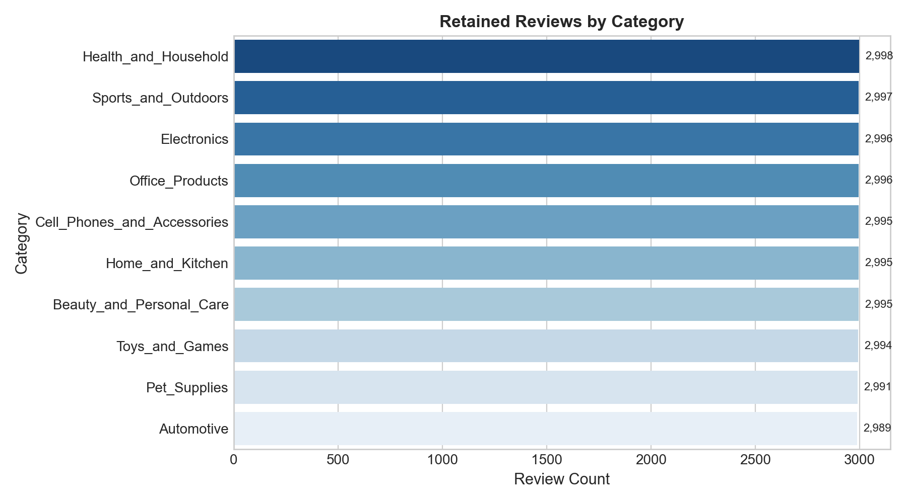
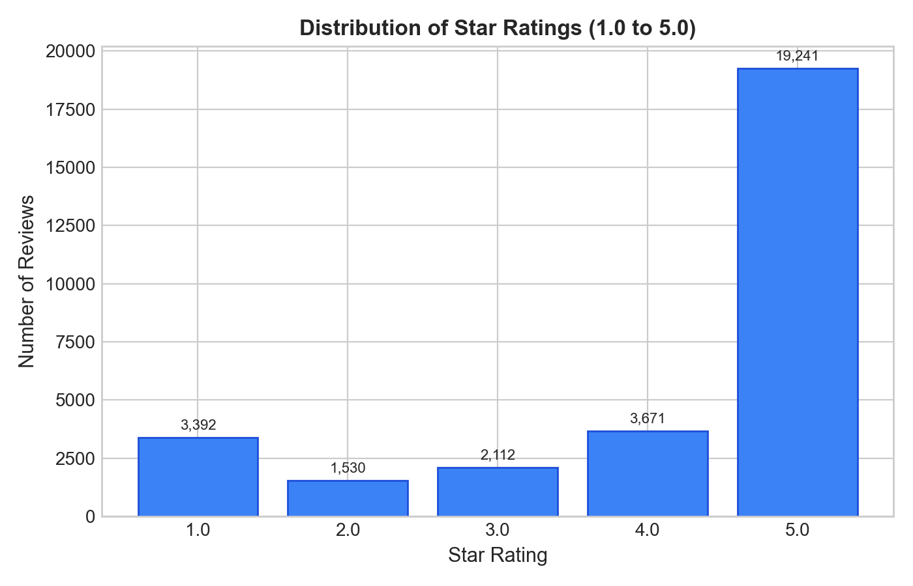
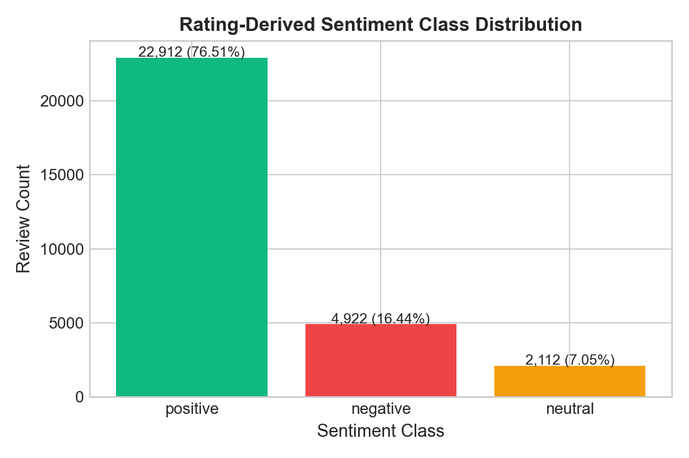
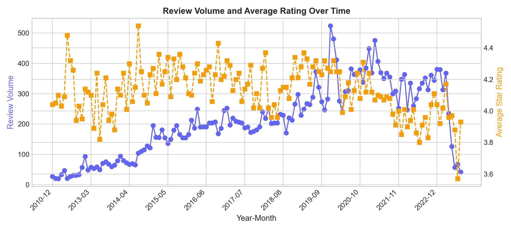
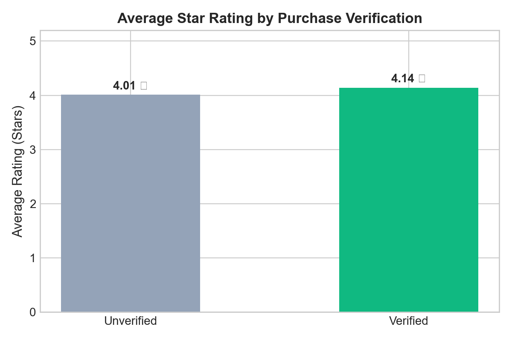

# ReviewRadar: Exploratory Data Analysis (EDA) Report

**Dataset Source:** McAuley-Lab / Amazon Reviews 2023  
**Analysis Engine:** DuckDB, Pandas, PyArrow  
**Dataset Path:** `data/processed/reviews_all.parquet`  
**Temporal Span:** 2000-05-20 to 2023-09-09  

---

## 1. Executive Summary & Key Dataset Metrics

This report presents empirical findings from real Amazon Reviews 2023 data across 10 retail categories. All values reported below are computed directly from the validated and cleaned Parquet dataset.

| Metric | Computed Value | Description |
| :--- | :--- | :--- |
| **Total Cleaned Reviews** | **29,946** | Retained records after schema validation & deduplication |
| **Unique Products (Parent ASINs)** | **26,360** | Distinct products represented across all categories |
| **Unique Customer Accounts** | **17,323** | Distinct reviewer accounts |
| **Date Range** | **2000-05-20 to 2023-09-09** | Earliest to latest review submission |
| **Positive Class (4–5★)** | **76.51%** | Strong positive sentiment majority |
| **Negative Class (1–2★)** | **16.44%** | Critical reviews (primary signal for product defects) |
| **Neutral Class (3★)** | **7.05%** | Mixed or lukewarm sentiment |

---

## 2. Category-Level Distribution & Comparison

Each category exhibits unique rating behavior and verified purchase dynamics:

| Category | Reviews | Unique Products | Mean Rating | Verified % | Mean Length | Helpful Votes/Review |
| :--- | :---: | :---: | :---: | :---: | :---: | :---: |
| `Health_and_Household` | 2,998 | 2,516 | 4.16★ | 91.3% | 210 chars | 2.05 |
| `Sports_and_Outdoors` | 2,997 | 2,734 | 4.22★ | 92.0% | 226 chars | 1.23 |
| `Electronics` | 2,996 | 2,625 | 4.12★ | 90.9% | 312 chars | 1.3 |
| `Office_Products` | 2,996 | 2,617 | 4.17★ | 92.2% | 194 chars | 0.85 |
| `Cell_Phones_and_Accessories` | 2,995 | 2,639 | 4.03★ | 94.5% | 203 chars | 0.68 |
| `Home_and_Kitchen` | 2,995 | 2,721 | 4.14★ | 91.8% | 222 chars | 1.77 |
| `Beauty_and_Personal_Care` | 2,995 | 2,604 | 4.1★ | 87.9% | 219 chars | 1.26 |
| `Toys_and_Games` | 2,994 | 2,724 | 4.13★ | 90.0% | 185 chars | 0.81 |
| `Pet_Supplies` | 2,991 | 2,385 | 4.07★ | 92.7% | 227 chars | 1.35 |
| `Automotive` | 2,989 | 2,795 | 4.16★ | 95.2% | 191 chars | 0.74 |

### Key Observations:
1. **Balanced intake by design:** each category was sampled with the same limit (2,989 to 2,998 reviews kept per category), so no single large category dominates. Reviews were taken from many small chunks spread over each source file, which gives many different reviewers (17,323 in total) and years. It is still a sample, not a random draw from all of Amazon.
2. **Rating differences between categories:** the highest average rating is `Sports_and_Outdoors` (4.22★) and the lowest is `Cell_Phones_and_Accessories` (4.03★).
3. **Verified purchases:** between 87.9% and 95.2% of reviews per category are verified purchases.

---

## 3. Rating Distribution & Sentiment Class Imbalance

Star ratings form the basis for our derived sentiment classification target:
- **Negative (1–2 Stars):** 16.44% of total records (4,922 reviews)
- **Neutral (3 Stars):** 7.05% of total records (2,112 reviews)
- **Positive (4–5 Stars):** 76.51% of total records (22,912 reviews)

| Star Rating | Review Count | Percentage |
| :---: | :---: | :---: |
| 1.0 Stars | 3,392.0 | 11.33% |
| 2.0 Stars | 1,530.0 | 5.11% |
| 3.0 Stars | 2,112.0 | 7.05% |
| 4.0 Stars | 3,671.0 | 12.26% |
| 5.0 Stars | 19,241.0 | 64.25% |

  

### Practical Modeling Implication:
Real-world e-commerce reviews suffer from significant **positive class imbalance** (over 76.51% positive). A naive model predicting "positive" for every review would achieve 76.51% accuracy while providing zero utility for detecting dissatisfied customers. Therefore, **Macro-F1** and per-class precision/recall must be the primary evaluation metrics rather than raw accuracy.

---

## 4. Review Text Length & Data Quality

| Length Metric | Computed Value |
| :--- | :--- |
| **Minimum Text Length** | 0.0 characters |
| **Median Text Length** | 116.0 characters |
| **Mean Text Length** | 218.9 characters |
| **Maximum Text Length** | 9181.0 characters |
| **Empty Reviews After Cleaning** | 5.0 (Filtered out during validation) |
| **Long Reviews (>2000 chars)** | 204.0 |

Customer reviews exhibit a classic right-skewed distribution. The median length of 116.0 characters shows that most shoppers leave concise, 2-to-4 sentence impressions, while a small minority write comprehensive multi-paragraph essays.

---

## 5. Temporal Trends & Purchase Verification Impact

  

- **Verification Impact:** Verified purchasers rate products at an average of **4.14★**, compared to **4.01★** for unverified submissions.
- **Helpful Votes Distribution:** 23.81% of reviews have received at least 1 helpful vote, with the maximum recorded being 1,543.0 votes.

---

## 6. Vocabulary & N-Gram Comparison

Top phrases identified via frequency analysis:

### Positive Reviews (Top Terms & Bigrams):
- `great` (2,396 occurrences)
- `good` (1,412 occurrences)
- `use` (1,134 occurrences)
- `love` (1,070 occurrences)
- `like` (1,056 occurrences)
- `easy` (964 occurrences)
- `just` (937 occurrences)
- `works` (895 occurrences)

### Negative Reviews (Top Terms & Bigrams):
- `product` (1,064 occurrences)
- `like` (900 occurrences)
- `just` (878 occurrences)
- `work` (826 occurrences)
- `don` (771 occurrences)
- `use` (720 occurrences)
- `good` (661 occurrences)
- `time` (642 occurrences)

---

## 7. Conclusions & Modeling Strategy

1. **Class Balancing Strategy:** Given the 76.51% / 7.05% / 16.44% split, we apply `class_weight='balanced'` in classical models (Logistic Regression and LinearSVC) to penalize minority-class errors proportionately.
2. **Feature Leakage Prevention:** Review star rating and metadata average ratings are strictly excluded from the feature matrix $X$. The models rely solely on text tokens.
3. **Evaluation Protocol:** Models will be compared using Macro-F1, per-class F1, and Confusion Matrices on a completely held-out test split.
